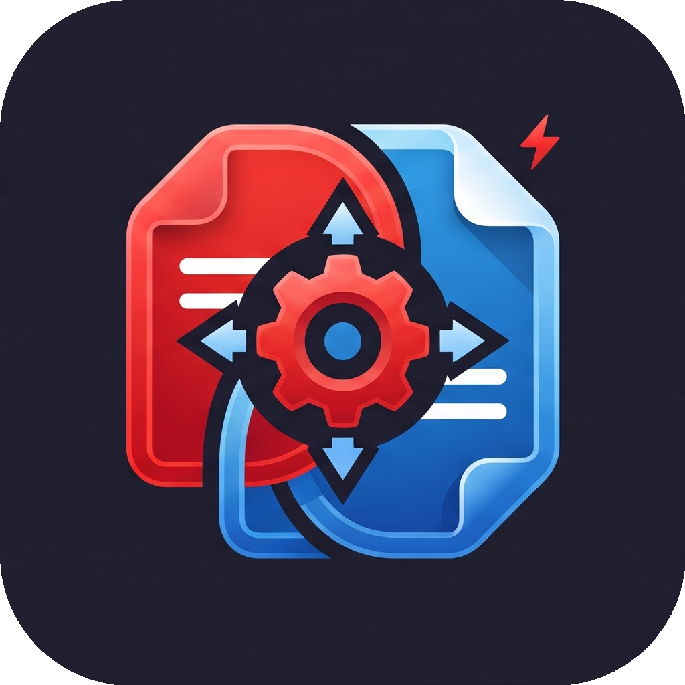
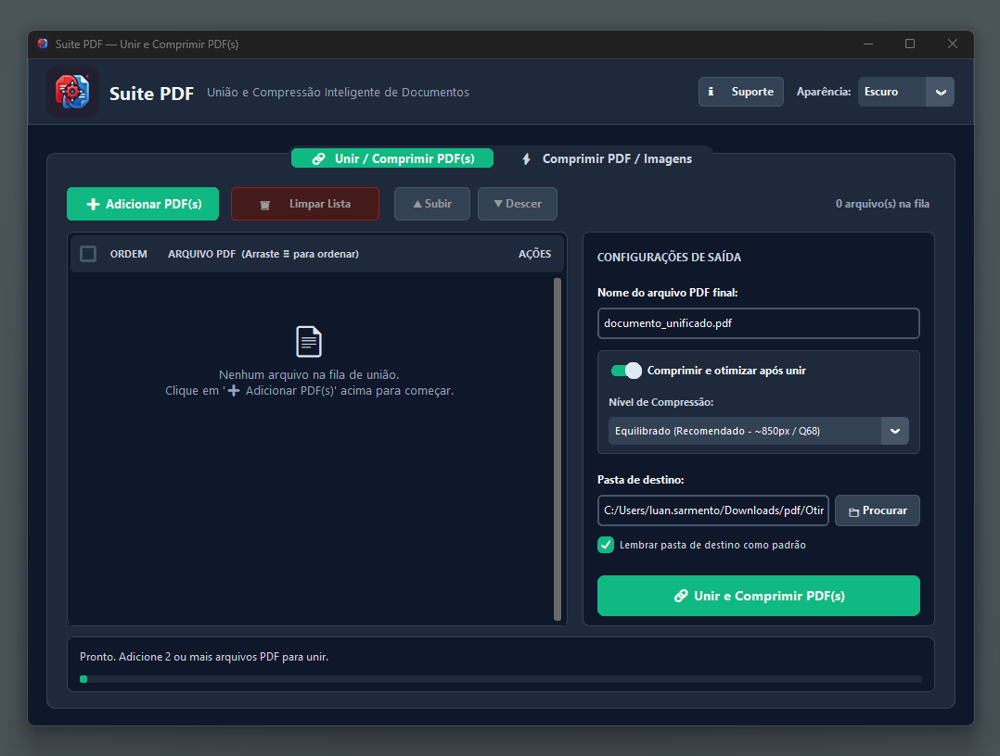

<p align="center">
  
</p>

<h1 align="center">Suite PDF</h1>

<p align="center">
  Um utilitário desktop completo, moderno e de alta performance desenvolvido em Python para <b>compressão universal de PDFs e imagens</b> e <b>união/mesclagem</b> de documentos PDF. 
</p>

<p align="center">
  Acompanha <b>Interface Gráfica (GUI)</b> elegante com Dark Mode / Light Mode adaptativo e um executável standalone <b><code>SuitePDF.exe</code></b> pronto para uso no Windows (sem necessidade de instalar Python).
</p>

<p align="center">
  
</p>

---

## Objetivo do Projeto

Muitos PDFs corporativos, apostilas, apresentações e contratos escaneados chegam a pesar dezenas de megabytes devido a:
- Capturas de tela e fotos salvas em resolução excessiva;
- Máscaras de canal alfa (`SMask`) redundantes e objetos duplicados;
- Falta de ferramentas simples e seguras para juntar vários documentos em um arquivo leve e organizado.

O **Suite PDF** resolve esses problemas com:
1. **Compressão Real de PDFs e Imagens:** Redução de **40% a 85%** no peso em KB/MB de PDFs e imagens avulsas (`.jpg`, `.jpeg`, `.png`, `.webp`, `.bmp`, `.tif`, `.tiff`), preservando legibilidade, nitidez e orientação EXIF de fotos.
2. **Compressão em Lote por Pasta:** Carregamento direto de pastas inteiras com dezenas ou centenas de imagens/PDFs, com opção de manter os nomes originais ou converter imagens para `.jpg`.
3. **União / Mesclagem de PDFs:** Concatenação de múltiplos documentos na ordem exata escolhida (com reordenação via drag-and-drop), com opção de comprimir o PDF unificado.
4. **Renomeação e Destino Flexíveis:** Edição do nome final, escolha de pasta de destino ou opção de **fixar pasta padrão**.
5. **Sem Artefatos Visuais:** Detecção adaptativa de transparência (`SMask` Modo A/B), evitando tanto retângulos pretos em documentos brancos quanto caixas brancas em slides escuros.
6. **Executável Windows Standalone:** Arquivo `.exe` único sem telas pretas de terminal.

---

## Como Usar o Executável (.exe)

O executável já compilado e pronto para distribuição encontra-se em:
```text
dist/SuitePDF.exe
```

1. Dê um duplo clique em `SuitePDF.exe`.
2. A interface gráfica abrirá instantaneamente em modo janela nativa.
3. Escolha a seção desejada:
   - **Aba "Unir / Comprimir PDF(s)":** Adicione os PDFs que deseja juntar, arraste os itens para reordenar ou use as setas, marque opcionalmente *"Comprimir e otimizar após unir"* e clique em **Unir e Comprimir PDF(s)**.
   - **Aba "Comprimir PDF / Imagens":** Adicione arquivos individuais (`➕ Adicionar Arquivo(s)`) ou uma pasta inteira (`📂 Adicionar Pasta`) contendo PDFs e/ou imagens (`.jpg`, `.png`, `.webp`, `.bmp`, `.tiff`). Escolha o nível de compressão (incluindo *Resolução Original*), o formato de saída para imagens (manter original ou converter para JPEG), defina se deseja manter os nomes originais em lote e clique em **Comprimir Arquivo(s)**.
4. Ao concluir, use os botões **📄 Abrir Arquivo** ou **📂 Abrir Pasta** para visualizar o resultado no Windows Explorer.

---

## Execução em Ambiente de Desenvolvimento

### 1. Instalação do UV e Preparação do Ambiente

O projeto utiliza o gerenciador **uv** para gerenciar dependências e o ambiente virtual com alta velocidade. Caso ainda não tenha o `uv` instalado em sua máquina, siga os passos abaixo:

#### Passo A: Instalar o UV

Se você já possui o Python e o `pip` instalados:
```bash
pip install uv
```

Alternativamente, via PowerShell (Windows):
```powershell
powershell -ExecutionPolicy ByPass -c "irm https://astral.sh/uv/install.ps1 | iex"
```

#### Passo B: Sincronizar o Ambiente e Dependências

Navegue até a pasta do projeto e execute a sincronização (o comando criará o ambiente virtual automaticamente e instalará todas as dependências):
```bash
cd c:\vscode\suite-pdf

# Sincroniza ambiente e dependências
uv sync
```

### 2. Iniciar a Interface Gráfica

```bash
uv run python src/main.py
# ou:
uv run suitepdf
```

### 3. Uso via Linha de Comando (CLI para Automações)

Se desejar executar rotinas automatizadas no terminal:
```bash
# Comprimir um arquivo PDF individual:
uv run python src/main.py "documento.pdf" -o "documento_leve.pdf" -q 68

# Comprimir uma imagem avulsa (mantendo resolução original com -m 0):
uv run python src/main.py "foto.png" -o "foto_leve.jpg" -q 75 -m 0

# Unir múltiplos arquivos em um só:
uv run python src/main.py "parte1.pdf" "parte2.pdf" "parte3.pdf" --unir -o "completo.pdf"
```

### 4. Compilar um Novo Executável (.exe)

Para gerar uma nova versão standalone do executável através do PyInstaller:
```bash
uv run pyinstaller suitepdf.spec --noconfirm
```
O `.exe` standalone será gerado em `dist/SuitePDF.exe`.

---

## 📂 Arquitetura do Projeto

O código-fonte foi refatorado e organizado diretamente em `src/`:

```text
suite-pdf/
├── assets/
│   ├── app_icon.ico              # Ícone oficial multi-resolução do Windows
│   └── app_icon.png              # Logo oficial em alta resolução
├── dist/
│   └── SuitePDF.exe              # Executável standalone distribuível
├── src/
│   ├── __init__.py
│   ├── compressor.py             # Motor universal de compressão de PDFs e imagens
│   ├── merger.py                 # Mecanismo de junção e concatenação ordenada
│   ├── gui.py                    # Interface Gráfica moderna (CustomTkinter)
│   └── main.py                   # Ponto de entrada (GUI padrão ou CLI com flags)
├── docs/
│   ├── README.md                 # Documentação técnica e engenharia em baixo nível
│   └── system_img.png            # Captura de tela da interface gráfica
├── suitepdf.spec                 # Especificação de empacotamento do PyInstaller
└── pyproject.toml                # Metadados e dependências do projeto
```

---

## Tecnologias Utilizadas

- **[CustomTkinter](https://customtkinter.tomschimansky.com/):** Interface gráfica moderna com suporte a temas Dark/Light e componentes fluidos.
- **[PyMuPDF](https://pymupdf.readthedocs.io/):** Motor em C de alto desempenho para manipulação de XObjects, streams e páginas PDF.
- **[Pillow (PIL)](https://pillow.readthedocs.io/):** Processamento e reamostragem de imagens com filtro Lanczos e quantização JPEG adaptativa.
- **[PyInstaller](https://pyinstaller.org/):** Empacotamento do runtime Python em um arquivo executável Windows de arquivo único (`--onefile --windowed`).
- **[UV](https://github.com/astral-sh/uv):** Gerenciador de pacotes e ambientes Python ultrarrápido.

---

## 📖 Documentação Técnica

Para detalhes sobre a especificação **ISO 32000 (PDF)**, o tratamento do canal alfa (`SMask`), a eliminação de duplicações na tabela XREF e os testes de compressão, consulte a **[Documentação Técnica em docs/README.md](docs/README.md)**.
