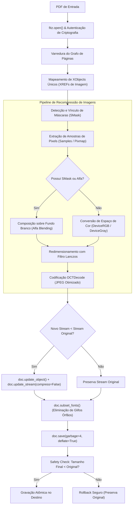

# Documentação Técnica — Arquitetura e Engenharia do File Compressor

Esta documentação detalha a engenharia interna do **File Compressor**, abordando os desafios inerentes à especificação **ISO 32000 (PDF)**, a manipulação de tabelas de referências cruzadas (`XREF`), o ciclo de vida dos fluxos binários (`streams`) e as estratégias de otimização aplicadas.

---

## 1. Visão Geral da Arquitetura

O processo de compressão de PDFs tradicionalmente falha ou gera arquivos maiores devido à natureza modular e baseada em grafos do formato PDF.



---

## 2. Anatomia Interna do PDF e Problemas Comuns

### 2.1. O que compõe um arquivo PDF?
Um arquivo PDF não é linear como uma imagem rasterizada; ele é uma coleção indexada de **Objetos Indiretos**:
```text
XREF 36: << /Type /XObject /Subtype /Image /Width 1129 /Height 1262 ... >>
stream
... [dados binários da imagem] ...
endstream
```
- **XREF (Cross-Reference Table):** Tabela que mapeia ponteiros em bytes para cada objeto dentro do arquivo.
- **XObjects:** Recursos compartilhados (como imagens e formulários) que podem ser instanciados dezenas de vezes em diferentes páginas sem duplicação de dados no arquivo físico.

### 2.2. Por que o código inicial aumentou o arquivo de 1668 KB para 1774 KB?
Quando se invoca métodos ingênuos como:
```python
doc.save("saida.pdf", garbage=4, deflate=True, clean=True)
```
Três comportamentos indesejados ocorrem:
1. **Nenhuma imagem é recompactada:** `deflate=True` aplica compressão zlib apenas em streams de conteúdo textual/vetorial. Imagens já compactadas (como JPEGs ou PNGs com Flate) permanecem com os mesmos bytes de pixel.
2. **Descompactação estrutural por `clean=True`:** Esse parâmetro instrui o MuPDF a "sanitizar" o PDF, o que muitas vezes descompacta dicionários e tabelas XREF compactadas em PDFs modernos (PDF 1.5+ com *Object Streams*), gravando-os em formato texto expandido.
3. **Crescimento de metadados:** A reescrita dos índices sem redução nos maiores consumidores de espaço (as imagens) gera overhead líquido positivo.

---

## 3. O Desafio das Máscaras de Transparência (`SMask`)

### 3.1. Como o PDF implementa transparência
Diferente do formato PNG, que incorpora o canal Alfa intercalado junto aos bytes de cor (RGBA), o padrão PDF divide a imagem em **dois objetos independentes**:
1. **XObject Base:** Uma imagem colorida RGB (`/ColorSpace /DeviceRGB`).
2. **XObject SMask (Soft Mask):** Uma imagem monocromática (`/ColorSpace /DeviceGray`) que serve como estêncil de opacidade de 0 (transparente) a 255 (opaco).

Muitos softwares (como Windows Snipping Tool, PowerPoint e macOS Preview) definem `/Matte [ 0 0 0 ]`. Isso significa que os pixels da imagem base foram pré-multiplicados com a cor preta onde a máscara é transparente.

### 3.2. A causa do "Retângulo Preto"
Se um script ingênuo simplesmente deleta o vínculo `/SMask` ou converte a imagem base para JPEG, o visualizador PDF renderiza a imagem base nua — revelando os pixels pretos pré-multiplicados do fundo, transformando diagramas e logos em blocos pretos opacos.

### 3.3. A Solução Implementada
O pipeline do **File Compressor**:
1. Lê o XObject base e busca a existência da chave `/SMask` no dicionário.
2. Extrai os bytes da máscara e instancia uma imagem monocromática de controle (`mode="L"`).
3. Cria uma tela branca pura `(255, 255, 255)` de dimensões idênticas.
4. Executa a mesclagem alfa (*alpha composite*) no Pillow:
   ```python
   bg = Image.new("RGB", im_base.size, (255, 255, 255))
   bg.paste(im_base.convert("RGB"), (0, 0), mask=im_mask)
   ```
5. Redefine o dicionário do objeto descartando o `/SMask`, transformando-o em um JPEG nativo de camada única. Na etapa final de salvamento, o coletor de lixo (`garbage=4`) detecta que a máscara de recorte ficou órfã e a expurga do arquivo, liberando espaço adicional.

---

## 4. O Pipeline de Otimização de Imagens

### 4.1. Reamostragem com Filtro Lanczos
Imagens capturadas em telas Retina/4K ou câmeras móveis possuem densidades de 200 a 300+ DPI. Para leitura em tela e impressão em folhas A4 comuns, resoluções acima de **120 a 150 DPI** representam bytes desperdiçados que o olho humano não distingue.

O redimensionador calcula a taxa de aspecto ideal e aplica o filtro **Lanczos (Sinc com janela de Lanczos)**, minimizando o efeito moiré e preservando o contraste de linhas finas de texto.

### 4.2. Codificação DCT (Discrete Cosine Transform) e Huffman
A imagem processada é salva em formato JPEG com:
- **`optimize=True`:** O Pillow constrói uma árvore de códigos de Huffman personalizada especificamente para as frequências daquela imagem, em vez de utilizar tabelas padrão estáticas.
- **`quality=68`:** Ponto ideal na curva de distorção de taxa (*rate-distortion curve*), eliminando ruídos de alta frequência sem produzir artefatos de bloco visíveis em tipografia.

### 4.3. Atualização de Baixo Nível no MuPDF
Para evitar que o PyMuPDF envolva o JPEG gerado em um segundo invólucro desnecessário de compressão zlib (o que corromperia o decodificador `/DCTDecode`), o stream é atualizado com:
```python
doc.update_object(xref, obj_def)
doc.update_stream(xref, jpeg_bytes, new=False, compress=False)
doc.xref_set_key(xref, "Filter", "/DCTDecode")
```

---

## 5. Otimização de Tipografia (Font Subsetting)

Documentos gerados por processadores de texto frequentemente embutem arquivos de fonte TrueType/OpenType inteiros (`/FontFile2`), contendo milhares de glifos para idiomas como grego, cirílico e kanji, mesmo que o documento utilize apenas o alfabeto latino básico.

A chamada:
```python
doc.subset_fonts()
```
Analisa todos os operadores textuais (`Tj`, `TJ`, `'`) do documento, constrói a tabela exata de caracteres utilizados e descarta todos os glifos não referenciados da fonte embutida. Em documentos ricos em texto, isso economiza centenas de kilobytes por fonte.

---

## 6. Coleta de Lixo Estrutural (`Garbage Collection`)

O método `doc.save(..., garbage=4)` ativa o nível mais agressivo do *Garbage Collector* da biblioteca MuPDF:
- **Nível 1:** Remove objetos não referenciados na tabela XREF.
- **Nível 2:** Agrupa fluxos de páginas órfãos.
- **Nível 3:** Compacta a tabela XREF eliminando buracos de objetos deletados.
- **Nível 4:** Realiza desduplicação profunda de fluxos binários e remove anotações desvinculadas.

---

## 7. Mecanismos de Tolerância a Falhas e Segurança

1. **Modo Assistido com Resolução Inteligente de Caminhos:** No modo interativo, o módulo de varredura `buscar_arquivos_pdf` inspeciona o grafo de diretórios filtrando ambientes virtuais (`.venv`, `.git`), calculando tamanho real de disco e exigindo confirmação explícita do usuário antes de iniciar qualquer leitura destrutiva ou transformação.
2. **Criptografia e Proteção por Senha:** Se o documento exigir permissão de leitura, o sistema autentica via chave vazia (padrão em documentos com restrição de edição mas leitura livre) ou utiliza o argumento `--senha`.
3. **Preservação Seletiva de Objetos:** Se uma imagem específica falhar durante a decodificação de cores, o erro é capturado e apenas aquele recurso é mantido em seu estado original, sem interromper o processamento das demais páginas.
4. **Escrita Atômica e Rede de Segurança (Safety Check):** O arquivo é inicialmente salvo em um arquivo temporário `.tmp`. Se o resultado for maior ou igual ao arquivo de origem, a operação é abortada sem alterar o arquivo do usuário.

