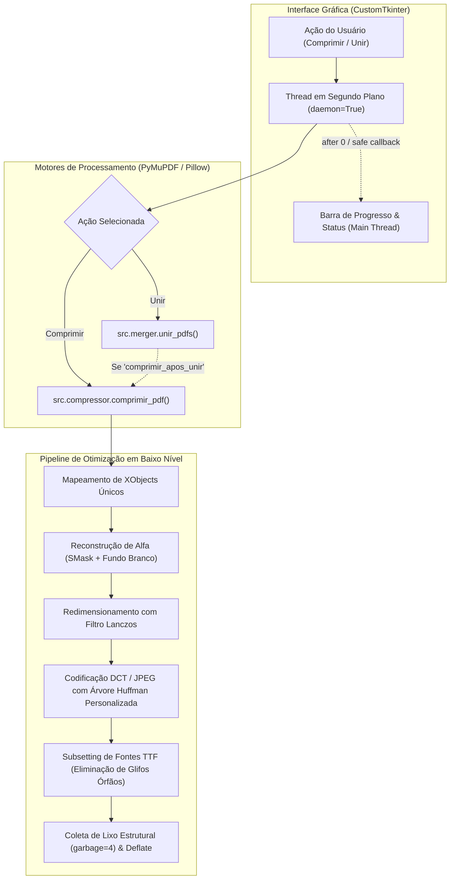

# Documentação Técnica — Arquitetura e Engenharia do Suite PDF

Esta documentação detalha a engenharia interna do **Suite PDF**, abordando os desafios inerentes à especificação **ISO 32000 (PDF)**, a manipulação de tabelas de referências cruzadas (`XREF`), o ciclo de vida dos fluxos binários (`streams`), as estratégias de mesclagem/união de documentos e a arquitetura da interface desktop compilada para Windows.

---

## 1. Visão Geral da Arquitetura

O sistema é dividido em três camadas desacopladas: motor de compressão (`compressor.py`), motor de união (`merger.py`) e a interface gráfica reativa (`gui.py`).



---

## 2. Anatomia Interna do PDF e Problemas Comuns

### 2.1. O que compõe um arquivo PDF?
Um arquivo PDF não é linear como uma imagem rasterizada; ele é uma coleção indexada de **Objetos Indiretos**:
```text
XREF 36: << /Type /XObject /Subtype /Image /Width 1129 /Height 1262 ... >>
stream
... [dados binários da imagem] ...
endstream
```
- **XREF (Cross-Reference Table):** Tabela que mapeia ponteiros em bytes para cada objeto dentro do arquivo.
- **XObjects:** Recursos compartilhados (como imagens e formulários) que podem ser instanciados dezenas de vezes em diferentes páginas sem duplicação de dados no arquivo físico.

### 2.2. Por que métodos ingênuos aumentam o tamanho do PDF?
Quando se invoca métodos genéricos como:
```python
doc.save("saida.pdf", garbage=4, deflate=True, clean=True)
```
Três comportamentos indesejados ocorrem:
1. **Nenhuma imagem é recompactada:** `deflate=True` aplica compressão zlib apenas em streams de conteúdo textual/vetorial. Imagens já compactadas (como JPEGs ou PNGs com Flate) permanecem intactas.
2. **Descompactação estrutural por `clean=True`:** Esse parâmetro instrui o MuPDF a "sanitizar" o PDF, o que muitas vezes descompacta tabelas XREF compactadas em PDFs modernos (PDF 1.5+ com *Object Streams*), gravando-os em formato texto expandido.
3. **Crescimento de metadados:** A reescrita dos índices sem redução nos maiores consumidores de espaço (as imagens) gera overhead líquido positivo.

---

## 3. O Desafio das Máscaras de Transparência (`SMask`)

### 3.1. Como o PDF implementa transparência
Diferente do formato PNG, que incorpora o canal Alfa intercalado junto aos bytes de cor (RGBA), o padrão PDF divide a imagem em **dois objetos independentes**:
1. **XObject Base:** Uma imagem colorida RGB (`/ColorSpace /DeviceRGB`).
2. **XObject SMask (Soft Mask):** Uma imagem monocromática (`/ColorSpace /DeviceGray`) que serve como estêncil de opacidade de 0 (transparente) a 255 (opaco).

Muitos softwares (como Windows Snipping Tool, PowerPoint e macOS Preview) definem `/Matte [ 0 0 0 ]`. Isso significa que os pixels da imagem base foram pré-multiplicados com a cor preta onde a máscara é transparente.

### 3.2. A causa do "Retângulo Preto"
Se um script ingênuo simplesmente deleta o vínculo `/SMask` ou converte a imagem base para JPEG, o visualizador PDF renderiza a imagem base nua — revelando os pixels pretos pré-multiplicados do fundo, transformando diagramas e logos em blocos pretos opacos.

### 3.3. A Solução Implementada
O pipeline do **File Compressor**:
1. Lê o XObject base e busca a existência da chave `/SMask` no dicionário.
2. Extrai os bytes da máscara e instancia uma imagem monocromática de controle (`mode="L"`).
3. Cria uma tela branca pura `(255, 255, 255)` de dimensões idênticas.
4. Executa a mesclagem alfa (*alpha composite*) no Pillow:
   ```python
   bg = Image.new("RGB", im_base.size, (255, 255, 255))
   bg.paste(im_base.convert("RGB"), (0, 0), mask=im_mask)
   ```
5. Redefine o dicionário do objeto descartando o `/SMask`, transformando-o em um JPEG nativo de camada única. Na etapa final de salvamento, o coletor de lixo (`garbage=4`) detecta que a máscara de recorte ficou órfã e a expurga do arquivo, liberando espaço adicional.

---

## 4. O Pipeline de Otimização de Imagens

### 4.1. Reamostragem com Filtro Lanczos
Imagens capturadas em telas Retina/4K ou câmeras móveis possuem densidades de 200 a 300+ DPI. Para leitura em tela e impressão em folhas A4 comuns, resoluções acima de **120 a 150 DPI** representam bytes desperdiçados que o olho humano não distingue.

O redimensionador calcula a taxa de aspecto ideal e aplica o filtro **Lanczos (Sinc com janela de Lanczos)**, minimizando o efeito moiré e preservando o contraste de linhas finas de texto.

### 4.2. Codificação DCT (Discrete Cosine Transform) e Huffman
A imagem processada é salva em formato JPEG com:
- **`optimize=True`:** O Pillow constrói uma árvore de códigos de Huffman personalizada especificamente para as frequências daquela imagem, em vez de utilizar tabelas padrão estáticas.
- **`quality=68`:** Ponto ideal na curva de distorção de taxa (*rate-distortion curve*), eliminando ruídos de alta frequência sem produzir artefatos de bloco visíveis em tipografia.

### 4.3. Atualização de Baixo Nível no MuPDF
Para evitar que o PyMuPDF envolva o JPEG gerado em um segundo invólucro desnecessário de compressão zlib (o que corromperia o decodificador `/DCTDecode`), o stream é atualizado com:
```python
doc.update_object(xref, obj_def)
doc.update_stream(xref, jpeg_bytes, new=False, compress=False)
doc.xref_set_key(xref, "Filter", "/DCTDecode")
```

---

## 5. O Mecanismo de União / Concatenação (`merger.py`)

A mesclagem de arquivos PDF requer cuidados com tabelas XREF independentes para evitar colisões de identificadores de objetos (`obj-id`):
1. **Instanciação Limpa:** Cria-se um documento destino vazio em memória (`fitz.open()`).
2. **Iteração Sequencial:** Itera-se pela lista de arquivos na ordem explicitamente selecionada pelo usuário.
3. **`insert_pdf()`:** A C-API do MuPDF recalcula todos os ponteiros de página, árvores de anotações e dicionários `/Resources`, mapeando recursivamente os novos índices sem duplicação de fontes compartilhadas.
4. **Pós-Otimização Opcional:** O arquivo consolidado pode passar diretamente pelo pipeline do `comprimir_pdf()`, garantindo que documentos unidos (que costumam somar centenas de megabytes) tenham seu peso otimizado de imediato.

---

## 6. Arquitetura da Interface Gráfica e Multithreading (`gui.py`)

Em aplicações desktop que manipulam arquivos pesados, operações síncronas bloqueiam o loop de eventos principal (`mainloop`), resultando no aviso de *"O aplicativo não está respondendo"*.

Para contornar isso:
1. **Threads de Trabalho (Worker Threads):** Todas as chamadas de compressão e união são executadas em instâncias de `threading.Thread(target=worker, daemon=True)`.
2. **Despacho Seguro de Eventos (`self.after`):** Como componentes Tkinter não são thread-safe, a thread de trabalho nunca modifica widgets diretamente. Em vez disso, ela despacha lambdas para a fila de eventos principal através de `self.after(0, lambda: self._atualizar_ui(...))`.
3. **Persistência de Preferências:** Um arquivo JSON leve armazenado no diretório do usuário (`~/.suitepdf_gui_config.json`) salva o tema visual (Dark/Light) e a preferência de pasta de destino fixa entre sessões.

---

## 7. Engenharia de Empacotamento PyInstaller (`suitepdf.spec`)

A criação de um executável standalone sem console para Windows envolve:
- **`console=False`:** Utiliza o bootloader `runw.exe` da Microsoft, que oculta a janela preta do prompt de comando.
- **`collect_all('customtkinter')`:** O CustomTkinter carrega dinamicamente temas JSON (`blue.json`, etc.) e fontes `.otf` do diretório do pacote. A função `collect_all` assegura que todos os 54 arquivos de assets sejam incorporados ao executável.
- **`collect_all('pymupdf')`:** Garante que todas as DLLs em C do motor MuPDF e extensões binárias estejam empacotadas no arquivo único (`--onefile`).
- **Resolução em Runtime (`sys._MEIPASS`):** Ao iniciar, o executável descompacta as bibliotecas na pasta temporária do Windows e inicializa o runtime Python de forma transparente para o usuário.
